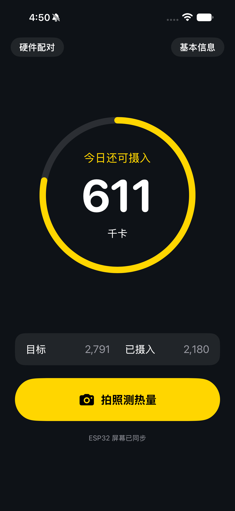
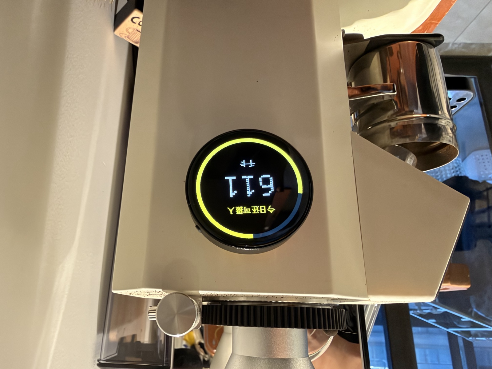

# esp32-intake

用手机拍照或选择相册图片，识别食物并估算热量，再把今日摄入进度同步到一块圆形 ESP32 屏幕上。

这是一个用于家庭局域网演示的饮食记录项目。App 强调先测量、再确认是否计入，屏幕则用圆环和颜色提醒当前摄入状态。

## Demo

<table>
  <tr>
    <td align="center"><strong>iOS App</strong></td>
    <td align="center"><strong>ESP32 屏幕</strong></td>
  </tr>
  <tr>
    <td></td>
    <td></td>
  </tr>
</table>

## 功能

### iOS App

- 拍照或从相册选择图片。
- 调用 MiniCPM-V-4.7-35B-A3B，识别食物并估算各项热量。
- 确认测量结果后加入今日摄入，也可以重新测量或选择“不吃了”。
- 加入前显示本次摄入对今日目标的影响。
- 根据性别、年龄、身高、体重、活动水平和体重目标计算每日热量目标。
- 本地保存当天摄入，跨天自动归零，也可在“基本信息”页一键清空今日摄入。
- 使用与 ESP32 一致的绿、黄、红状态颜色。

### ESP32 屏幕

- 使用 Waveshare ESP32-S3-Touch-AMOLED-1.75。
- 466×466 圆形 AMOLED，中央显示剩余热量。
- 外圈显示今日摄入比例，从顶部顺时针增长。
- 摄入低于 70% 为绿色，70%–99% 为黄色，达到或超过目标为红色。
- 通过局域网 HTTP 接收 App 推送的完整状态，不在屏幕上自行累加。

## 工作原理

```text
拍照 / 相册图片
    ↓
iOS App → ModelBest HTTPS API → 食物及热量估算
    ↓
用户确认是否计入
    ↓
本地保存今日摄入
    ↓ HTTP POST /update
ESP32-S3-Touch-AMOLED-1.75 显示剩余热量与摄入圆环
```

当前 Demo 通过 ModelBest API 在线调用模型，并非在手机上本地运行模型。

每日目标使用 Mifflin–St Jeor 公式计算 BMR，再乘活动系数，并按增减重目标调整。估算结果仅供一般健康参考，不构成医疗建议。

## 项目结构

```text
ios/CalorieIntake/          SwiftUI App
  Sources/                  界面、模型调用、持久化及同步
  Config/                   本地配置与示例
firmware/                   PlatformIO / Arduino 固件
  src/main.cpp              屏幕、Wi-Fi 与 HTTP 服务
  include/                  引脚及 Wi-Fi 配置
```

## 环境要求

### App

- Xcode 27 或兼容版本
- XcodeGen
- iOS 17 或更高版本
- ModelBest API Key

### 固件

- PlatformIO
- Waveshare ESP32-S3-Touch-AMOLED-1.75
- 2.4 GHz Wi-Fi

## 配置

真实秘密配置已加入 `.gitignore`，不要提交 API Key、Wi-Fi 密码或包含这些内容的构建产物。

### 1. App 配置

```bash
cp ios/CalorieIntake/Config/Secrets.example.xcconfig ios/CalorieIntake/Config/Secrets.xcconfig
```

编辑 `Secrets.xcconfig`：

```text
MODELBEST_API_KEY = YOUR_MODELBEST_API_KEY
ESP32_BASE_URL = http:/$()/YOUR_ESP32_IP
```

`ESP32_BASE_URL` 只填写 `http://ESP32_IP`，不要附加路径。ESP32 烧录并联网后，可从串口日志查看实际 IP。

### 2. ESP32 配置

```bash
cp firmware/include/Secrets.example.h firmware/include/Secrets.h
```

在 `Secrets.h` 中填写 Wi-Fi 名称和密码：

```cpp
#define WIFI_SSID "YOUR_WIFI_SSID"
#define WIFI_PASSWORD "YOUR_WIFI_PASSWORD"
```

## 构建与运行

### App

```bash
cd ios/CalorieIntake
xcodegen generate
open CalorieIntake.xcodeproj
```

在 Xcode 中选择自己的开发团队，连接 iPhone 后运行。首次使用需要允许相机和本地网络权限，并按系统提示信任开发者。

### ESP32

```bash
pio run -d firmware
pio run -d firmware -t upload --upload-port /dev/cu.usbmodem3101
```

串口波特率为 `115200`。如果端口不同，请替换 `--upload-port`。手机与 ESP32 必须连接到同一个局域网。

## HTTP 接口

- `GET /health`：返回当前摄入与目标。
- `POST /update`：使用 `application/x-www-form-urlencoded`，参数为 `kcal=<已摄入>&target=<每日目标>`。

示例：

```bash
curl --noproxy '*' -X POST -d 'kcal=500&target=2000' http://ESP32_IP/update
```

## 安全与发布说明

当前 API Key 随 App 安装在设备上，只适合局域网 Demo。若要对外分发，应将模型调用迁移到后端代理，避免在客户端暴露密钥。
